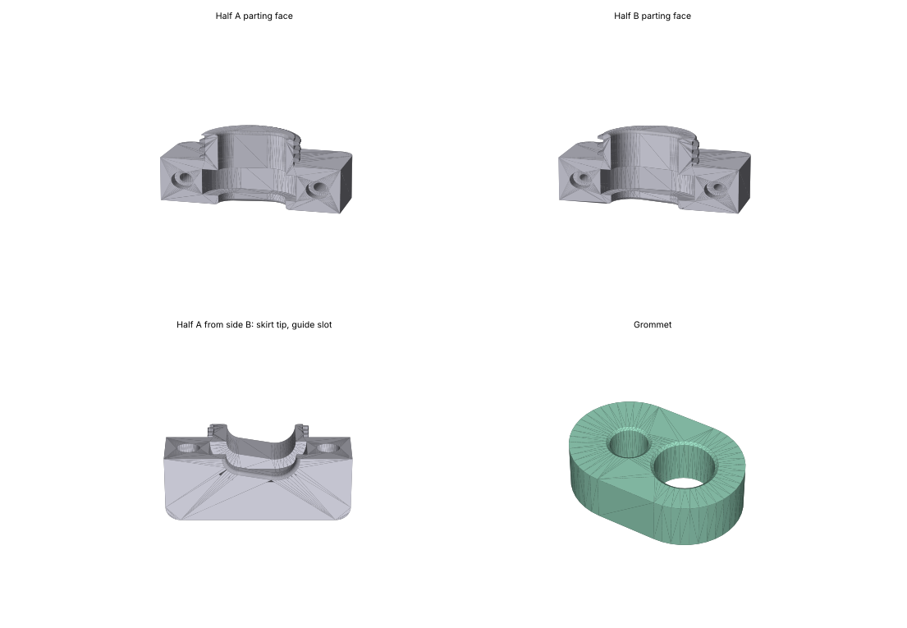

# Split cord grip for a 3/4" knockout — two cables with pre-terminated right-angle connectors

Status: **v3 PRINTED, BEING FITTED.** The halves, nut and grommet have been printed; the pocket
measured 0.375" as modelled and the grommet 0.40" (too tall — fixed in v3.1, grommet only). A v1
nut had been printed earlier with no bore (generator bug, fixed in v2 — see "Lessons" below). The
knockout diameter and nut-over-connector fit are not yet recorded here.



## Problem

Two cables have to enter the TC22 control cabinet through a 3/4" trade-size conduit knockout
(nominal 1.109" / 28.2 mm; **measure it**, a punched hole may be 1.050"):

| cable | OD | connectors |
|---|---|---|
| small | 0.250" (6.35 mm) | right-angle, both ends, pre-terminated |
| large | 0.375" (9.525 mm) | right-angle, both ends, pre-terminated |

Requirements: light moisture/coolant-mist seal, chafe protection, pull-out resistance (loads are
low; this is a stationary cabinet, not an airframe). Because both cables have large connectors on
both ends, nothing with a closed bore can be slipped over them — the body **must** be a split
clamshell. A right-angle connector *can* be snaked through a thin ring by tilting it, which is
what makes the thin retaining nut (and the panel hole) workable; it cannot pass through a bore
with any length, which is why a one-piece body is impossible.

## Design

Five printed parts (`split_grommet.py` generates all of them):

| part | material | qty | what it is |
|---|---|---|---|
| `body_half_A` | PETG/ASA | 1 | Clamshell half, y>0. Flange + half of the threaded skirt. M3 **clearance** holes (Ø3.4) with Ø6.5×6 counterbores on the outer wrench flat. |
| `body_half_B` | PETG/ASA | 1 | Clamshell half, y<0. Same, but Ø2.5 **tap-drill** holes — tap M3 after printing. |
| `grommet` | TPU 95A | 1 | Oblong (stadium) block, one bore per cable, captured in a closed pocket inside the flange. Printed solid; each bore is **razor-slit after printing**, straight out to the nearest flat (±Y) face. |
| `nut` | PETG/ASA | 1 | 36 AF hex, 5 mm thick, internal thread. Thin so it can pass over the right-angle connectors. |
| `collar` | PETG/ASA | 2 | Ø6.0×5.8 sleeve, Ø3.4 bore. Seats in Ø6.3×3 recesses on both parting faces, centres the halves; bolts pass through it. |

Plus hardware: 2× M3×30 SHCS, RTV on the parting faces at assembly, a dab of RTV on the nut thread.

Geometry (v3, as generated):

- Cable axes are parallel to Z, lie in the parting plane y=0, 9.24 mm apart in X.
- Flange 50 × 38 × 16 mm, square-cornered (r4). The 38 mm faces are wrench flats; the bolt axes
  run along Y through them at x = ±18.79, z = 8.
- Skirt: Ø27.5 major / Ø24.5 minor, 3 mm pitch trapezoidal (30° included), 10 mm long with 1 mm
  unthreaded relief at the flange and a 1 mm lead-in chamfer at the tip. Major is
  `HOLE_D − 0.5` snapped to 0.5 mm.
- Guide slot through the skirt and flange end walls: convex hull of Ø7.95 and Ø11.1 circles
  (cable + 1.6 mm), 18.8 × 11.1 mm, 1 mm fillets at both exits for chafe. Leaves 2.86 mm of skirt
  wall at the slot ends — the script refuses to build below 2.0.
- Grommet 26.8 × 17.5 × **9.0** mm, bores Ø5.7 (small) and Ø8.8 (large), 2.0 mm web between
  them, 0.5 mm chamfers on all bore edges. Pocket is 26.3 × 17.0 × 9.5: 0.25 mm radial squeeze
  per side (that is what seals and grips) and **0.5 mm axial clearance** — v3 had 0.5 mm axial
  *interference* and the printed grommet came out 0.40" tall for a 0.375" pocket (TPU also
  prints ~0.15 mm tall), which only fought the halves closing. Fixed 2026-11-04; the halves are
  unchanged, only the grommet needs reprinting.
- Nut: thread clearance 0.3 mm radial and on both flanks. **Nut bore (minor + clearance) is
  Ø25.1 mm — every connector must pass through this, not the Ø28.2 panel hole.**
- Thread fit is checked in 2D on the generating cross-sections (exact for this construction).

Load path for pull-out toward side B (into the cabinet): cable → grommet friction → pocket wall →
flange → panel; the nut carries nothing. Toward side A: through the 2–3 engaged printed threads.
Both are fine for the stated loads.

## Assembly order

1. Slip the nut over the smaller connector end of each cable, onto the cables (side B).
2. Pass both connectors through the panel hole.
3. Slit the grommet bores; open the slits and lay both cables in, slit side toward the flat face.
4. RTV the parting faces. Drop the two collars into half B's recesses. Close half A over the
   grommet and cables and bolt with M3×30 into half B's tapped holes.
5. Push the skirt through the panel from side A; hold the flange on its wrench flats; thread the
   nut on from side B. Dab of RTV on the thread.

## Printing

| part | orientation | notes |
|---|---|---|
| halves A, B | **parting face down** | Flat first-layer parting face; vertical bolt/tap holes; the half-skirt is a dome so the thread needs no support; the pocket/slot are 17 mm and 11 mm arches that bridge fine. **Enable elephant-foot compensation (~0.15 mm)** or the two half-threads meet with a step at the seam. ≥4 perimeters. |
| nut | flat, either face down | internal thread prints without support (15° flanks) |
| grommet | flat, bores vertical | **100 % solid** (or ≥20 walls so it is all perimeters): the pocket squeeze only reaches the cable if the rubber has no voids to collapse into. Dry the TPU. Expect bores ~0.2 mm under nominal; measure and adjust `bore` in `CABLES`. |
| collars | standing, bore vertical | |

Print the **nut first** and check it passes over both connectors; then one collar to check the
recess fit (if it won't drop in, `RECESS_D = 6.4`); then the rest.

## Regenerating

```bash
pip install cadquery            # ~1 GB; cadquery 2.8 / OCP 7.9 was used
python3 split_grommet.py        # STEP + STL into ./out, plus assembly.step for fit checks
python3 split_grommet.py --no-threads   # plain cylinders, fast fit-check prints
```

Everything is in the `PARAMETERS` block at the top; the layout (cable positions, grommet/pocket
outline, slot, flange length, bolt positions) is computed from the `CABLES` list, so a third
cable or a different diameter is a one-line edit. The script prints the layout, runs validity,
through-bore, thread-gap and interference checks, and exits non-zero if any fail. Runs in ~35 s.
Only the STLs are committed here (`stl/`); STEP files and the assembly are regenerated.

Parameters most likely to need touching after the first print:

| parameter | default | when |
|---|---|---|
| `HOLE_D` | 28.2 | measured knockout differs (1.050" → 26.7) |
| `CABLES[i]["bore"]` | 5.7 / 8.8 | grommet bores print under/over size |
| `GROMMET_AXIAL_CLR` | 0.5 | grommet still binds axially in the pocket (TPU printing tall) |
| `BOLT_TAP_D` | 2.5 | tap tears PETG instead of cutting → 2.6–2.7 |
| `RECESS_D` | 6.3 | collars won't drop in |
| `THREAD_CLR` | 0.3 | nut binds / too sloppy |
| `NUT_T` | 5.0 | nut won't pass the connector (thinner) |

## Lessons / gotchas (CadQuery + OCC)

- **Helical sweeps make booleans fail silently.** Sweeping a thread profile along `makeHelix`
  (Frenet or not) produced a valid-looking solid that OCC then refused to fuse/cut/intersect —
  the boolean returned one of its arguments with no error. This is how the v1 nut came out with
  no bore. Threads are now built by **`twistExtrude`-ing the thread's perpendicular
  cross-section** (radius as a function of angle, 72 points/turn), which yields core + tooth as one
  solid and booleans cleanly.
- The script now checks volumes after every thread operation and probes every bore with a
  cylinder; trust those checks over a pretty render.
- A 3D boolean between the nut and the skirt (two nearly-coincident helical surfaces) never
  finishes. The thread fit is checked in 2D instead.
- `cq.exporters.export(..., "svg")` (hidden-line) hangs on the threaded parts. Render from the
  STL (matplotlib `Poly3DCollection`) instead.
- OCC caches tessellation on the shape; STL exports at the default 0.02 mm tolerance were 70 MB
  per part. Defaults are now 0.05 mm / 0.3 rad (~4–5 MB).

## History

- v1 (2026-11-01): single Ø6.35 cable, hex flange, symmetric halves, helix-swept threads.
  Nut printed with no bore (see above).
- v2: twistExtrude threads; halves made distinct (A clearance + counterbore, B tap-drill);
  centering collars added; square flange (a hex has no flat face where the bolts land).
- v3 (2026-11-03): two cables (0.25" + 0.375") through one oblong grommet; layout computed
  from the `CABLES` list; flange 50 × 38. Halves and nut printed.
- v3.1 (2026-11-04): grommet shortened to 9.0 mm (0.5 mm axial clearance in the 9.5 mm pocket)
  after the first print measured 0.40" tall against a 0.375" pocket. Halves unchanged.
